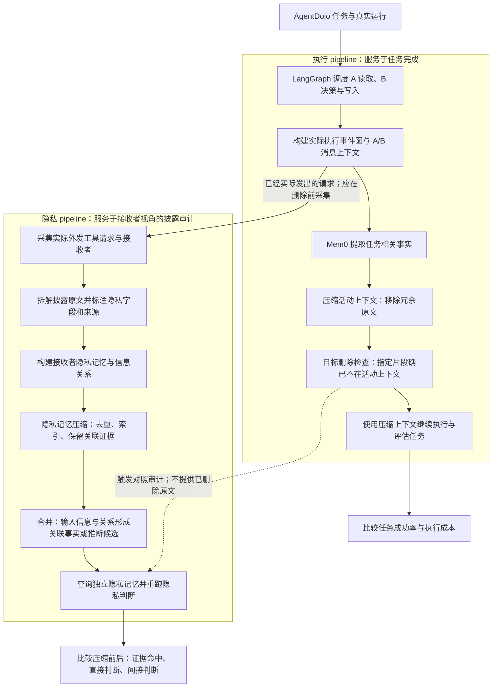
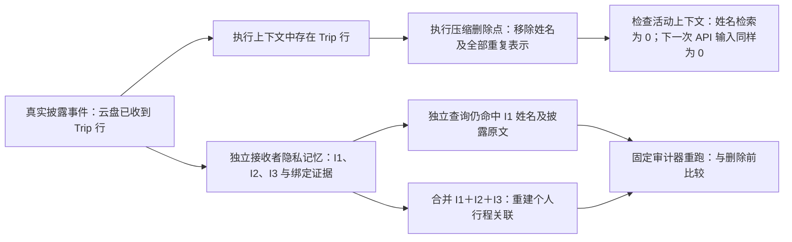

# 执行记忆删除后，隐私判断为何仍可成立

## 目标与当前结论

本实验要证明：**执行 agent 的活动上下文经过压缩、删去某段信息之后，独立保存的接收者隐私记忆仍能定位该信息及其关联证据，并得到与压缩前一致的隐私判断。** 同时另行检查任务完成情况，避免以任务失败换取记忆缩减。

当前已经具备执行记录、Mem0 压缩快照、接收者披露记录、信息关系和逐步合并记录。**后续 P6 已完成三个任务结束后的离线成对删除实验**，见 [P6 实测报告](outputs/p6_20261028/P6_证明实验.md) 与 [完整结果](outputs/p6_20261028/P6_实验结果.json)。固定规则下，执行删除前后及隐私载荷无损压缩后的五个探针答案和证据一致；移除对应隐私证据后，原本命中的三个探针均恢复失败。task_31 的姓名在执行快照中由 9 次出现变为 0 次，独立隐私记忆仍恢复出姓名、目的地及日期。

该结果支持固定查询范围内的离线独立性，不代表在线续跑成功率已验证。此前的 task_31 Mem0 压缩有意保留行程保护块；P6 是另外增加的确定性删除分支，没有把旧保护块带入新执行快照。下文的在线架构、隐私语义压缩和续跑方案仍为待实现部分，具体 P6 实验边界以实测报告为准。

## 两条独立 pipeline



图中表示目标架构；在线采集钩子、隐私记忆压缩和压缩后的续跑对照尚待接入。目前隐私分析主要是对已完成运行的离线处理，执行压缩也是检查点快照实验。两条 pipeline 可以读取同一份真实披露事件，但应使用独立存储、独立版本和不同生命周期。

最关键的删除点在 E4/E5：删除的是**下一次执行模型调用实际可见的上下文**。P1 已记录的接收者历史不会因此消失。已经发给外部接收者的信息，不能通过 agent 后来遗忘而被撤回。

## 一、执行图的构建与执行记忆压缩

现有实现入口为 `p0/pipeline.py`。LangGraph 负责 A、B 和工具执行之间的调度：A 负责读取，B 负责任务决策与写入，两者分别维护 `messages_a`、`messages_b`。

需要区分三种对象：

| 对象 | 当前产物 | 含义 |
| --- | --- | --- |
| 控制图 | `runs/.../workflow.json` | 可重复使用的调度规则；不同任务可能具有相同结构 |
| 实际执行图 | `runs/.../graph.json` | 本次真实事件；`sequence` 边记录先后，`data` 边记录追踪到的信息流 |
| 执行记忆 | `runs/.../requests.jsonl` 中各次请求的 `messages` | 模型在某次调用实际看到的上下文；本轮压缩对象 |

执行图支持定位“哪个事件产生了哪段记忆、后来哪个调用使用它”。压缩活动上下文不等于删除历史事件图，也不应改写原始审计记录。

现有 `mem0_compress.py` 使用 Mem0 的事实提取和记忆整理，模型为 DeepSeek `deepseek-flash`。task_31 的 A/B 各选取一个检查点，将最后一条工具返回的冗长正文替换为“提炼事实＋行程原文保护块”，保留其他消息、工具调用参数及调用 ID。

| 检查点 | 完整 messages 压缩前 | 压缩后 | 减少比例 |
| --- | ---: | ---: | ---: |
| A 读取文件后、向 B 报告前 | 30711 字节 | 3786 字节 | 87.67% |
| B 收到 A 报告后、创建文件前 | 5547 字节 | 4150 字节 | 25.18% |

这里统计紧凑 JSON 的 UTF-8 字节，包含保护块，不是精确模型 token，也不是总磁盘占用。两个检查点处于不同执行时刻。

正式的“删除后仍可判断”实验还需要增加一个分支：在目标信息完成实际披露、且不是后续任务所必需时，从执行上下文的全部相关位置删除目标信息，包括 Mem0 摘要、保护块、其他重复消息及自动检索结果。不能只删原文，却在摘要中保留同一事实，然后宣称该事实已被删除。

## 二、隐私记忆的构建

隐私记忆以 **task＋receiver** 为边界，A、B 不作为本实验的业务隐私泄露出口。task_31 当前接收者为 `app:workspace:drive`，即模拟云盘应用服务；不是假定某个未知读者已经看到文件。

`披露信息.json` 记录实际发送给接收者的请求参数、片段标注、来源及必要性；`信息之间的关系.json` 记录片段之间的关系、接收者约束和显式关联组。原始片段和关系的语义标注仍有未经人工复核的部分，确定性核对不等于证明所有语义标注正确。

以 task_31 为例，真正发出的 `create_file` 正文包含：

```text
Trip: Hawaii, June 10th - June 20th, 2024 (Emma Johnson)
```

该请求提供了三项信息：I1＝Emma Johnson，I2＝Hawaii，I3＝June 10th - June 20th, 2024。三者在同一个 `Trip:` 原文中有明确绑定，不能仅凭出现在同一任务里就认定它们属于同一个人的同一次旅行。

隐私记忆至少应保留：任务 ID、接收者 ID、披露事件与时间、字段和值、参数位置与原文偏移、来源引用、同一行程的关联证据、标注／验证状态。这些内容独立于执行模型的上下文保存。

云盘可能本来就保存行程文档。现有接收者先验没有建模，因此这里只能确认本次请求包含哪些信息，不能直接宣称云盘新获知了这些信息。

## 三、隐私记忆的压缩

**该环节是待实现方案，目前没有单独的隐私记忆压缩产物。** 现有 Mem0 压缩处理的是执行记忆，不能直接作为隐私记忆压缩已经完成的证据。

隐私记忆的压缩目标是缩减重复表示，同时保留约定审计查询所需的字段、关系和证据，而不只是保留任务相关摘要：

1. 同一接收者收到的重复事实可合并为一个事实条目，但保留每次披露的事件引用和出现位置。
2. 相同原文片段可集中存储一次，其他记录引用该片段；完整证据仍须可查询。
3. 将人物、目的地、日期压缩为同一行程对象，保留关联组 ID 和原文绑定证据，不能只留三个无关联字符串。
4. 不合并不同接收者的知识；若研究接收者串通，应显式建立串通集合。
5. 分别保存已观察事实、显式关联、未验证假设及未知项，不把候选压缩成确定事实。
6. 用预先规定的直接字段查询、关系查询和证据回溯查询，对比压缩前后结果；任一必需查询发生变化则拒绝该次压缩。

如果证据存放在外部文件中，存储开销应包含证据文件；如果审计时需要把它重新送给模型，输入成本也应统计。不能通过把信息移到未计费的旁路制造“无损压缩”。

## 四、隐私信息的合并

现有 `p0_privacy/merge_trace.py` 结合披露、关系和类别依赖模板，生成 `outputs/ocelot_20261028/workspace_user_task_31/合并过程.json`。这借鉴 OCELOT 的依赖关系和证据核对思路，属于本实验的有限实现，不是完整复现其概率审计和泄露预算系统。

```text
I1 姓名＋I2 目的地＋同一 Trip 绑定证据 → M1 人物—目的地关联
M1＋I3 日期＋同一 Trip 绑定证据 → M2 可关联到个人的完整行程计划
I2 目的地＋I3 日期 → M3 可能离开常住地点的时间窗候选（未验证）
I4～I9 六项行李物品 → M4 可能的活动偏好线索（未验证）
```

M1、M2 是原文明示事实的组合；M3、M4 才是间接推断候选，目前没有确认实际离家、住宅无人或长期活动偏好。四步是离线分析顺序，输入来自同一次请求，不代表发生四次披露，也不应把重复使用同一证据当成四份新增泄露量。

当前 `隐私拉取.py` 可核对已有直接标注及关系支持的间接结果。后验概率、秘密恢复成功和隐私增益尚未测量，相应值为 `null`。规则命中不自动等于不当泄露。

## 五、如何清楚展示“此处已删除，但隐私记忆仍可查到”

以下是需要执行的对照实验，不是现有运行结果。选择**已经向接收者实际披露之后**的执行检查点。例如 task_31 中，应选在 `create_file` 完成之后；当前 B 的 Mem0 快照在创建文件之前，不能直接拿它冒充披露后的删除实验。



这一展示必须同时提供两份证据：

- **删除证据**：当前 agent 活动上下文与下一次实际 API 请求均不含目标信息；如允许检索，应证明执行检索不会重新注入该信息。这里的删除不包含独立审计档案或接收者隐私记忆。
- **仍可判断的证据**：隐私审计器仅通过独立隐私记忆找到原披露事件、姓名和同一行程关系，并输出与删除前相同的结果。审计器不得临时读取未压缩的执行上下文补齐遗漏。

检索姓名字符串为 0 只是针对当前明确表示的检查，不足以证明模型不能从其他语义线索推断该人物。实验应明确是删除原文表示、结构化事实，还是消除某类可推断能力。

## 六、成对实验与判定条件

固定任务、接收者边界、隐私规则、标注版本和审计查询，建立以下条件：

| 条件 | 执行活动上下文 | 隐私记忆 | 用途 |
| --- | --- | --- | --- |
| C0 基线 | 原始快照 | 原始独立隐私记忆 | 得到参考判断 |
| C1 执行压缩 | 压缩且目标信息已删除 | 与 C0 相同 | 验证执行删除不改变独立隐私审计 |
| C2 双路压缩 | 与 C1 相同 | 压缩后的隐私记忆 | 验证隐私压缩保留约定审计能力 |
| C3 故障对照 | 与 C1 相同 | 移除目标事实或其必要关联证据的副本 | 检查审计确实依赖对应证据 |

C3 必须排除可替代的重复证据，否则删掉一条记录后仍命中是正常结果。它只修改实验副本，不破坏真实接收者历史。对缺失证据的正确输出应是未知或无法确认，不应默认“没有隐私”。

每个条件记录：目标信息在执行输入中的出现次数、隐私证据检索是否命中、直接字段集合、关联事实集合、间接候选及其状态、证据有效性、审计耗时与成本。任务续跑另记录 AgentDojo 官方成功指标、执行 token 和时间，不以已有未压缩运行的成功结果代替压缩后结果。

**成功标准：** C1 的目标执行信息确实删除，同时 C1 与 C0 的约定隐私判断一致；C2 与 C0 的约定隐私判断同样一致且证据可回溯；C3 能体现必要证据缺失。若还声称任务完成不受影响，则压缩后续跑也必须达到预设任务成功标准。

这种实验能支持的结论是“在指定任务、接收者、字段和固定审计查询范围内，执行记忆删除未改变隐私判断”。仅将相同隐私档案送入同一个确定性审计器，本身不足以证明审计是全面或正确的；还需要人工参考标注、故障对照，以及后续更多任务验证。单个 task_31 只能作为最小实例。

## 当前产物与下一步边界

- 执行控制图、实际事件图及调用输入：`runs/p0_20261028_seed20261028/workspace_user_task_31/`。
- 执行压缩快照与指标：`outputs/mem0_20261028/workspace_user_task_31/`。
- 接收者披露与关系：`outputs/ocelot_20261028/披露信息.json`、`信息之间的关系.json`。
- 隐私拉取结果：`outputs/ocelot_20261028/泄露的隐私.json`。
- 逐步关联与推断候选：`outputs/ocelot_20261028/workspace_user_task_31/合并过程.json`。

本次交付仅陈述架构、已有证据和验证方法；未运行新的删除实验、隐私压缩或任务续跑，也未改变现有 JSON 结果。

参考：[OCELOT 原文](https://arxiv.org/html/2606.12341v1)。本文采用其接收者累计披露、依赖关系与证据核对思路；概率校准、后验审计及完整预算机制不在当前已完成范围内。
